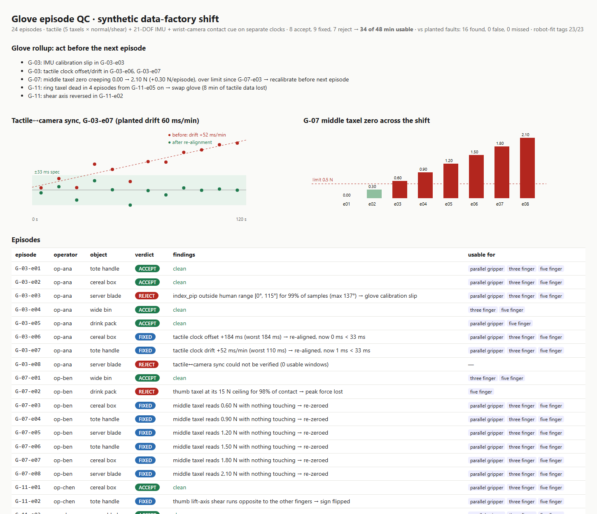

# Glove-episode QC for tactile + IMU + camera data (prototype)

**The problem.** Intelligence Factory's [whitepaper](https://intelligence-factory.com/blog/foundation-models-for-robotic-manipulation) describes data factories where people wear gloves with a 21-DOF IMU hand tracker and **tri-axial tactile sensors (normal + shear)**, plus head and wrist RGB-D cameras. A wrist edge device fuses them. Quality comes from "a 17-step quality-check process", and the first steps are "timestamp calibration of sensor outputs and ensuring hardware and software work as expected". Then the data is **retargeted** from 21-DOF hands to grippers and 3-finger hands. The plan: 500 collectors and 1.25M hours a year. At that scale the expensive failures are silent:
- a tactile taxel that died mid-shift
- a zero offset creeping up on one finger
- a shear axis mounted backwards
- an IMU joint reading an angle no human finger can reach
- tactile contact that lags the camera
- an episode that's fine for a 5-finger hand but impossible for a parallel gripper

**What I built.** QC for a whole shift of glove episodes:

| Check | How | Result |
|---|---|---|
| Tactile ↔ camera sync | windowed cross-correlation of tactile contact force vs. wrist-camera proximity, Theil-Sen offset/drift fit, re-align, **re-verify** (< 33 ms) | `SYNC_REALIGNED` / `SYNC_UNVERIFIED` |
| Zero drift | taxel force while the camera says nothing is touched | re-zero → `ZERO_DRIFT` |
| Dead taxel | taxel doesn't respond to contact while the hand grips > 3 N | `TAXEL_DEAD` |
| Saturation | taxel pinned at its ceiling during contact → peak force lost | `TAXEL_SATURATED` |
| Shear polarity | lift-axis shear runs opposite to the other fingers | flip → `SHEAR_REVERSED` |
| IMU anatomy | joint outside human range (e.g. PIP > 115°) → calibration slip | `JOINT_OUT_OF_RANGE` |
| Retargeting fit | grasp aperture and grip force vs. each robot body (parallel gripper 85 mm / 40 N, 3-finger 110 mm / 30 N, 5-finger) | "usable for" tags |

Each episode gets **ACCEPT / FIXED / REJECT** with reasons. A **glove rollup** tells ops what to do *before the next episode*: "G-07 middle taxel zero creeping +0.30 N/episode → recalibrate", "G-11 ring taxel dead from e05 → swap glove".

## Result (synthetic shift: 3 gloves × 8 episodes × 2 min, 3 sensor clocks)

- 8 ACCEPT · 9 FIXED · 7 REJECT → **34 of 48 min usable**.
- **16/16 planted faults found, 0 false, 0 missed.** Robot-fit tags are correct on 23/23 measurable episodes. The same plan run with 3 more random seeds gives **0 errors across 96 episodes**. Those runs caught and fixed two of my own bugs along the way:
  - a "low variance = dead" test that wrongly flagged a light-grip pinky
  - 20 s sync windows that let one noisy window fake a drift
- Sync: a planted +180 ms offset is recovered as +184 ms. A planted 60 ms/min drift is estimated at 52 ms/min, and the re-aligned stream re-verifies at 1 ms.
- Honest limits: this is synthetic data from my own simulator. The camera "contact cue" is a hand–object distance signal, not real depth video. The thresholds are guesses that would need tuning on real gloves.



## Run

```bash
pip install -r requirements.txt
python demo.py            # generates the seeded shift (~56 MB, not committed), runs QC → out/report.html
python -m pytest -q       # 7 tests (includes a second random seed)
```

## Layout

```
gloveqc/synth.py   simulator: tactile 200 Hz, IMU 100 Hz, wrist cam 30 Hz on separate clocks + planted faults
gloveqc/qc.py      sync (adapted from my human-archive-episode-qa-prototype), tactile health, IMU anatomy, retargeting fit, glove rollup
demo.py            shift run, scoring vs planted faults, HTML report with sync + drift charts
```

Unofficial prototype by Kushagra Pratap Singh. Not affiliated with Intelligence Factory.
